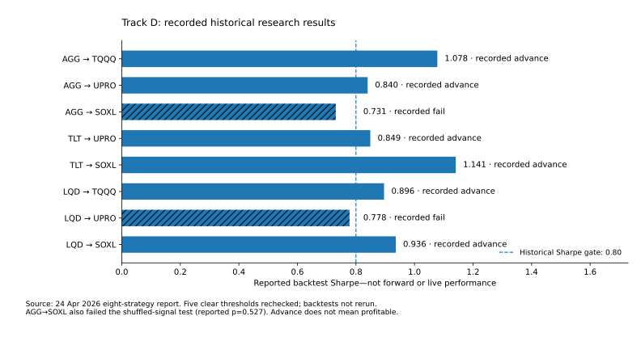
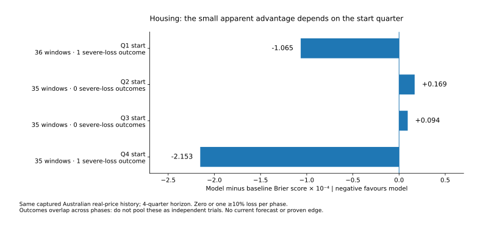

# llm-quant

## Open quantitative research. Results you can inspect.

A Python lab for market-risk scenarios, housing indicators, paper strategies and
project economics. Deterministic code calculates results; LLMs assist research.
**Research only. No validated investment edge or live-trading approval.**

[Start here](#start-here) · [Results](#what-worked-and-what-failed) ·
[Contribute research](CONTRIBUTING.md) · [Documentation](docs/README.md) ·
[Repository map](docs/repository-map.md)

## Start here

| Your goal | Start with |
| --- | --- |
| Try a model without credentials | The offline example below |
| Understand the evidence | [Model audit](docs/research/model-audit-2026-11-11.md) |
| Submit an idea, replication or negative result | [Research contribution guide](docs/contributing/research.md) |
| Find code, data contracts or experiments | [Repository map](docs/repository-map.md) |
| Reproduce the housing study | [Decision Lab commands and limits](DECISION_LAB.md) |
| Review a contribution | [Reviewer checklist](docs/contributing/review.md) |

### Offline quick start

Use Python 3.12+ and a virtual environment. No API key, broker or paid feed is needed.
Fork this repository for contributions; clone your fork and work from its root.

```sh
python -m venv .venv
# Activate .venv (see CONTRIBUTING.md for your platform).
python -m pip install numpy==2.3.5 pytest==9.0.2
PYTHONPATH=src python -m llm_quant.decision_lab demo
PYTHONPATH=src python -m pytest -q tests/test_decision_lab.py tests/test_decision_lab_study.py tests/test_decision_lab_evidence.py
python -m unittest discover -s tests -p test_research_docs.py
python scripts/check_research_docs.py
```

For PowerShell, set `$env:PYTHONPATH = "src"` and omit the `PYTHONPATH=src` prefix.
The demo is **synthetic**. It demonstrates the pipeline, not market performance.
Private inputs and downloaded histories belong in gitignored `research-local/`.

## What worked and what failed

**Evidence review: 11 November 2026.** These are different kinds of evidence;
a passing software test is not a profitable strategy.

| Research area | Finding | Evidence status |
| --- | --- | --- |
| Eight-strategy April Track D cohort | Six recorded advances; two failures. Original backtests were not rerun. | Recorded historical results |
| D3 TQQQ/TMF | Records retire it after a signal bug changed reported Sharpe from 2.21 to -1.08. | Recorded failed replication |
| Housing loss model | Calculation reproduced; its small baseline advantage reverses with the starting quarter. | No robust forecasting edge established |
| Latest paper report inspected, 6 November | No portfolio snapshots; displayed zeros do not prove a flat return. | Performance unavailable |
| Earlier 42.8% CAGR / 2.205 Sharpe claims | Original prices, complete ledger and runs not independently reproduced in this audit. | Unverified here |

### Historical strategy outcomes



AGG to SOXL failed the historical Sharpe threshold and shuffled-signal check;
LQD to UPRO failed the Sharpe threshold. An advance means **further testing**, not
proven profitability. The audit also identifies two mislabelled cross-validation
metrics. [Exact values, qualifications and sources](docs/research/model-audit-2026-11-11.md).

### Housing evaluation sensitivity



The study uses 225 quarterly observations, 1970 Q1-2026 Q1, from a captured
BIS/FRED eight-city Australian **real-price index**, not Sydney alone or an
investable total-return series. Annual outcomes overlap across starting phases:
do not pool them as independent trials. Sparse loss events and latest-vintage
observations do not establish calibrated current crash probabilities.

[Machine-readable results](docs/evidence/model-audit-2026-11-11.json) ·
[Original test receipt](docs/evidence/verification-2026-11-11.json) ·
[Evidence catalogue](docs/evidence/README.md)

## Contribute research

**Useful contributions include reproductions, failed hypotheses, data corrections,
tests and clearer explanations. A high backtest return is not an entry requirement.**

1. Open a [research proposal](.github/ISSUE_TEMPLATE/01-research-proposal.md),
   [replication/result](.github/ISSUE_TEMPLATE/02-replication-result.md), or
   [data/engineering issue](.github/ISSUE_TEMPLATE/03-data-engineering.md).
2. Agree on a bounded question, baseline, data rights and resource budget.
   Freeze confirmatory methods before seeing the evaluation outcomes.
3. Submit a small PR with reproducible commands, evidence and limitations using
   the [contribution guide](CONTRIBUTING.md) and [research templates](docs/templates/README.md).

External contributors do not need Beads, private accounts or an LLM subscription.
Maintainers link accepted public issues into the existing internal Beads workflow.
Negative or inconclusive results are welcome; do not tune a failed test into a pass
without recording the new trial and a new evaluation plan.

## Repository layout

```text
src/llm_quant/       Implementation and research modules; existing imports retained
  decision_lab/     Isolated scenarios, source checks and project economics
config/             Explicit settings and synthetic examples
scripts/            Entry points and reproducible figure generation
tests/             Software and evidence-contract tests
data/strategies/   Existing strategy lifecycle records (not raw market data)
docs/              Navigation, contribution guides, governance and evidence
reports/           Historical paper/scan reports; missing data stays missing
research/          Existing experiment manifest, prompts and result records
research-local/    Gitignored local data, private inputs and run output
```

See the [detailed map](docs/repository-map.md) for responsibilities and naming rules.
Existing source modules, strategy IDs and historical records have not been moved.

## Verification and limitations

The dated model audit records **131 focused tests passing locally**, not a full
legacy-suite pass. [Organisation checks](docs/evidence/organisation-2026-11-11.json)
record the separate documentation/template verification and rerun in this update.
Hosted CI was blocked by an account billing issue in the inspected runs; **no green
CI claim is made**. Full-repository lint/type checks, original strategy replication,
live-source ingestion and prospective validation remain outstanding.

Repository publication is not model promotion or approval to trade. No new paid
feeds, brokerage access, recurring ingestion or private data are introduced.
See [research governance](docs/governance/research-tracks.md) for the existing
strategy mandates; conflicting claims must be reconciled, not silently replaced.

## License

Code contributions: [MIT](LICENSE). Dataset permissions are separate. Do not
publish licensed market histories, private account records, client data or secrets.
