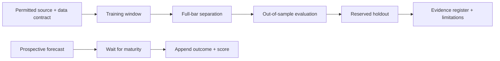

# llm-quant

## Open quantitative research. Results you can inspect.

A Python lab for market-risk scenarios, housing indicators, paper strategies and
project economics. Established numerical libraries calculate results; LLMs assist
research. **Research only. No validated investment edge or live-trading approval.**

[Start here](#start-here) · [Results](#what-worked-and-what-failed) ·
[Research policy](RESEARCH_POLICY.md) · [Contribute](CONTRIBUTING.md) ·
[Documentation](docs/README.md) · [Repository map](docs/repository-map.md) ·
[Library integrations](docs/research/integrations.md) · [Agent skills](docs/skills/README.md)

## Start here

| Your goal | Start with |
| --- | --- |
| Run an example without credentials | The offline reference below |
| Review established methods used here | [Standards and reuse](docs/research/standards-and-reuse.md) |
| Understand historical successes and failures | [Model audit](docs/research/model-audit-2026-11-11.md) |
| Submit a replication, idea or negative result | [Research contribution guide](docs/contributing/research.md) |
| Find code, source contracts or experiments | [Repository map](docs/repository-map.md) |
| Reproduce the housing diagnostics | [Decision Lab commands](DECISION_LAB.md) |
| Review a contribution | [Reviewer checklist](docs/contributing/review.md) and [current policy](RESEARCH_POLICY.md) |

### Offline reference: one command after installation

Use Python 3.13.5 in an isolated environment for the pinned reference. No API key,
broker account, paid data feed or LLM subscription is required. Fork and clone the
repository, then run from its root:

```sh
python -m venv .venv
# Activate .venv; see CONTRIBUTING.md for your platform.
python -m pip install -r requirements/research-py313.lock
PYTHONPATH=src python -m llm_quant.decision_lab.benchmark --reference
PYTHONPATH=src python -m pytest -q tests/test_decision_lab*.py
python scripts/check_research_standards.py --environment
PYTHONPATH=src python -m llm_quant.decision_lab.catalog --check
```

For PowerShell, set `$env:PYTHONPATH = "src"` and omit the `PYTHONPATH=src` prefix.
The reference is **artificial**, explicitly marked `SYNTHETIC_REFERENCE_NOT_MARKET_EVIDENCE`.
It checks the mechanics; it is not a profitable strategy or a market forecast.
Private inputs and downloaded histories stay in gitignored `research-local/`.

## Library-backed modelling and QA

| Capability | Implemented boundary |
| --- | --- |
| Time-aware backtesting | scikit-learn `TimeSeriesSplit`, a full-bar gap, and separately reserved holdout; not full event-label CPCV |
| Portfolio baselines | Cash, rebalanced equal weight, equal-weight buy-and-hold, shrinkage inverse volatility and long-only shrinkage minimum variance |
| Covariance estimation | scikit-learn `LedoitWolf`, fitted on training data only |
| Numerical optimization | SciPy SLSQP; failed fits stop instead of silently falling back |
| Transaction costs | Self-financing buys/sells, explicit commission/slippage assumption, cash residual and accounting tests |
| Statistical diagnostics | statsmodels Holm correction for the complete declared family; exact binomial intervals only under an explicit independence assumption |
| Prospective records | Local append-only forecast/outcome journal; premature scoring, duplicates and corruption rejected |
| Evidence consistency | Hash-checked public register generates the status table below; changed evidence requires review |



**Publication is not promotion.** Local timestamps and hashes need an independent
retained anchor to establish a prospective record. No real forward forecast was
issued by this engineering increment, and no live-trading path was added.
[Exact methods, timing, cost conventions, upstream sources and limits](docs/research/standards-and-reuse.md).

## Established projects, connected to runnable research

Nine upstream projects now have a defined role in the repository. These are
original adapters calling public APIs, not vendored code or a claim that every
upstream feature is integrated.

| Project | Implemented integration | Local runtime evidence |
| --- | --- | --- |
| scikit-learn | Chronological splits, shrinkage covariance and cost-aware allocation evaluation | Executed |
| statsmodels | HAC mean inference and multiple-testing diagnostics | Executed |
| skfolio | Minimum variance and empirical CVaR allocation | Optional runtime not installed; contract checks executed |
| arch | Stationary-bootstrap mean intervals and GARCH-t variance | Optional runtime not installed; contract checks executed |
| Backtesting.py | Next-open entry/exit and commission diagnostic | Optional runtime not installed; AGPL opt-in |
| Microsoft Qlib | Local experiment metadata via QlibRecorder/MLflow | Optional runtime not installed; contract checks executed |
| CVXPY | Explicit capped empirical CVaR program | Optional runtime not installed; native/cross-engine tests supplied |
| Pandera | Strict OHLC schema | Optional runtime not installed; prerequisite validation executed |
| Hypothesis | Generated accounting/conservation tests | Optional runtime not installed; property tests supplied |

```sh
PYTHONPATH=src python -m llm_quant.decision_lab.integrations doctor
PYTHONPATH=src python -m llm_quant.decision_lab.integrations probe sklearn
PYTHONPATH=src python -m llm_quant.decision_lab.integrations probe statsmodels
PYTHONPATH=src python -m llm_quant.decision_lab.integrations compare-synthetic \
  --method sklearn_inverse_volatility
python scripts/check_quant_integrations.py
```

Seven project skills are available under `.claude/skills/`: research routing, data
contracts, backtesting, portfolio/risk, statistical validation, experiment evidence
and integration QA. They point to actual code and tests, require the current
policy, and grant no trading, spending or account-management permissions.
[Skills and invocation guide](docs/skills/README.md).

**Verification:** 341 focused tests passed; eight optional native checks skipped
because dependencies are absent. Mocked contracts are not native-library passes.
The manual native workflow rejects missing or skipped selected tests. No manual
native job was dispatched in this update. Full legacy/hosted/lint/type verification
and a clean all-framework dependency resolution remain outstanding.
[Exact receipt](docs/evidence/integrations-2026-11-11.json) ·
[API boundaries and commands](docs/research/integrations.md) ·
[Attribution and licenses](THIRD_PARTY_RESEARCH.md).

## What worked and what failed

This table is generated from [the research register](docs/evidence/research-register.json).
A passing software test is not a successful investment. Historical records remain
unchanged; the new methods do not rehabilitate rejected or unverified strategies.

<!-- research-register:start -->
| Study | Evidence status | Finding |
| --- | --- | --- |
| [track-d-april-cohort](docs/evidence/model-audit-2026-11-11.json) | Historical record; not independently rerun | Six recorded advances and two failures in the reviewed eight-strategy cohort; original backtests not rerun. |
| [d3-tqqq-tmf](docs/research/model-audit-2026-11-11.md) | Recorded failed replication | Retired in the inspected records after a signal bug. A stale positive paper row does not reinstate it. |
| [housing-phase-diagnostic](docs/evidence/model-audit-2026-11-11.json) | Retrospective research; no established edge | Tiny baseline advantage changes sign across starting quarters; zero or one severe-loss outcome per phase. |
| [latest-inspected-paper-report](reports/daily/2026-11-06.md) | Performance evidence unavailable | The 6 November report contains no portfolio snapshots; its zero returns are not verified performance. |
| [cost-aware-reference](docs/evidence/synthetic-reference-2026-11-11.json) | Artificial fixture; not market evidence | Five predeclared baselines exercised on an artificial fixture; no market-performance or profit claim. |
<!-- research-register:end -->

### Historical strategy outcomes


AGG to SOXL failed the historical Sharpe threshold and shuffled-signal check;
LQD to UPRO failed the Sharpe threshold. An advance meant further testing, not
proven profitability. The audit also identifies mislabelled cross-validation
metrics. [Exact values and source qualifications](docs/research/model-audit-2026-11-11.md).

### Housing evaluation sensitivity


The historical study uses 225 quarterly observations, 1970 Q1-2026 Q1, from a
captured BIS/FRED eight-city Australian real-price index, not Sydney alone or total
investment returns. Annual outcomes overlap across starting phases; do not pool
them as independent trials. No new housing study or current crash forecast is
claimed by the hardening increment.

[Historical machine-readable results](docs/evidence/model-audit-2026-11-11.json) ·
[New artificial reference](docs/evidence/synthetic-reference-2026-11-11.json) ·
[New test receipt](docs/evidence/hardening-2026-11-11.json)

## Contribute research

Reproductions, failed hypotheses, data corrections and tests are useful
contributions. A high backtest return is not an entry requirement.

1. Open a [research proposal](.github/ISSUE_TEMPLATE/01-research-proposal.md),
   [replication/result](.github/ISSUE_TEMPLATE/02-replication-result.md), or
   [data/engineering issue](.github/ISSUE_TEMPLATE/03-data-engineering.md).
2. Agree on a bounded question, permitted data, baseline, costs and resource budget.
   Freeze confirmatory methods and holdouts before inspecting outcomes.
3. Submit reproducible code, all attempted variants and the relevant negative tests.
   Use [CONTRIBUTING.md](CONTRIBUTING.md), [research templates](docs/templates/README.md)
   and [RESEARCH_POLICY.md](RESEARCH_POLICY.md).

Test future-data mutation, accounting conservation, costs, bad inputs and missing
evidence. Record code/source identities and the exact environment. Never change a
failed threshold after seeing the result without registering a new experiment.
Maintainers can link public issues to Beads; contributors need no private access.

## Repository layout

```text
src/llm_quant/       Existing research and paper modules; imports preserved
  decision_lab/     Sources, scenarios, baselines, journal and result catalogue
    integrations/   Explicit upstream adapters and held-out comparisons
.claude/skills/     Seven repo-local research procedures with executable entry points
config/             Explicit plans and artificial examples
requirements/       Pinned focused environment and separate QA tool versions
scripts/            Reproducible reports, documentation and policy checks
tests/              Numerical, leakage, accounting and evidence contracts
data/strategies/    Historical strategy lifecycle records, not raw vendor data
docs/               Research, review instructions and hash-linked evidence
reports/            Historical reports; missing data is not zero performance
research/           Existing experiment manifests, prompts and results
research-local/     Gitignored local inputs and run output
```

## Verification boundaries

The hardening receipt records executed focused tests and reference runs. It is
**not a full legacy suite, formatting/typecheck or hosted-CI pass**. The runtime
could not download missing tooling or obtain a full checkout. The new workflow
repairs `master` triggers and installs project dependencies before full checks;
its execution is still an acceptance requirement. Existing billing-blocked runs
must not be relabelled green.

The focused environment is pinned to observed installed versions. It is not a
wheel-hash-verified or fully resolved lock for every legacy dependency. Real source
ingestion, original-strategy replication, release-aware vintages, calendar/FX checks
and forward forecasting remain unverified where the evidence says so.

Current policy supersedes old promotional status claims in historical mandates;
it never weakens numerical risk controls. No new paid feed, live trade, recurring
ingestion or private-data publication is authorized.

## License

Code: [MIT](LICENSE). Dataset rights are separate. No upstream implementation
source was copied in this increment; dependencies retain their own licenses.
