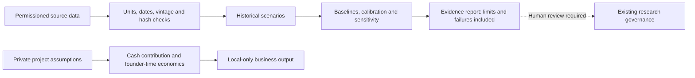

# llm-quant

## Quantitative research, with an evidence trail

A Python research lab for market-risk scenarios, housing indicators, paper strategies
and project economics. Deterministic code calculates results; LLM-assisted research
is not a substitute for source data, validation or an execution record.

**Evidence review: 11 November 2026 · Research only · No validated investment edge established**

[Decision Lab](DECISION_LAB.md) · [Detailed model audit](docs/research/model-audit-2026-11-11.md) ·
[Machine-readable results](docs/evidence/model-audit-2026-11-11.json) ·
[Test receipt](docs/evidence/verification-2026-11-11.json) · [Existing research governance](docs/governance/research-tracks.md)

> This page separates **software tests**, **recorded backtests**, **reproduced historical
> diagnostics** and **forward performance**. None is interchangeable with another.
> The earlier chat probability tables are not verified model outputs and are not inputs
> to this lab. No trading or model promotion is authorized by this update.

## Did the previous models work?

| Research area | What the evidence supports | Verdict |
| --- | --- | --- |
| Track D, eight-strategy April cohort | Six recorded advances to further testing; two recorded failures. Five unambiguous numerical thresholds rechecked; underlying backtests not rerun. | **Mixed historical results—not verified profitability** |
| D3 TQQQ/TMF mean reversion | Existing research records retire it after a signal bug changed the reported Sharpe from 2.21 to −1.08. | **Recorded failure; do not reinstate from a stale paper log** |
| Australian housing risk model | Original historical calculation reproduced; all four annual starting phases examined. Small score advantage changes sign with the starting quarter. | **No robust forecasting edge demonstrated** |
| Latest committed daily paper report | The 6 November report contains no portfolio snapshots, despite displaying zeros and a hash-chain PASS footer. | **Missing evidence—not a verified 0% return** |
| Earlier 42.8% CAGR / 2.205 Sharpe claims | Historical README claims were located, but their original prices, complete trade ledger and runs were not reproduced in this audit. | **Unverified here; not an achievable-return forecast** |
| Decision Lab engineering | 131 focused tests pass locally. Full legacy suite, hosted CI, formatter and type checker are not green/verified. | **Focused checks pass; repository-wide acceptance pending** |

Scope: one explicitly identified eight-strategy cohort, selected contradictory records,
the latest committed daily report, and the housing module. This is **not** a claim to
have retested every hypothesis or every legacy strategy in the repository.

### 1. Historical strategies: show the failures as well as the advances


| Strategy | Reported Sharpe | Recorded outcome | Material qualification |
| --- | ---: | --- | --- |
| AGG → TQQQ | 1.078 | Advance | CPCV ratio is mislabelled in the narrative summary. |
| AGG → UPRO | 0.840 | Advance, marginal | Only slightly above the historical 0.80 Sharpe threshold. |
| AGG → SOXL | 0.731 | **Fail** | Below Sharpe threshold; shuffled-signal p = 0.527. |
| TLT → UPRO | 0.849 | Advance | Historical parameter sensitivity remains relevant. |
| TLT → SOXL | 1.141 | Advance | Further paper validation was required. |
| LQD → TQQQ | 0.896 | Advance, brittle | Several parameter variants reportedly deteriorated sharply. |
| LQD → UPRO | 0.778 | **Fail** | Below Sharpe threshold; parameter fragility reported. |
| LQD → SOXL | 0.936 | Advance | Rebalance sensitivity reported. |

Source: [24 April 2026 cohort report](docs/research/results/track-d-robustness-results-2026-04-24.md).
The frozen source blob and SHA-256 are in the results JSON. “Advance” means the
historical report recommended the next research stage, **not that the strategy made
money out of sample**. A rounded shuffled p-value of 0.0000 is not an exact zero.

**Two metric-label defects were found.** In the primary JSON records, AGG→TQQQ has
mean out-of-sample Sharpe **1.0912** and an out-of-sample/in-sample ratio **1.0123**.
LQD→UPRO has corresponding values **0.6637** and **0.8536**. The narrative summary
labels the first numbers as ratios. The audit retains that column as ambiguous and
does not claim independent validation of a sixth gate.
See [AGG→TQQQ record](data/strategies/agg-tqqq-sprint/robustness_results.json) and
[LQD→UPRO record](data/strategies/lqd-upro-sprint/robustness_results.json).

D3's retirement is recorded in [research governance](docs/governance/research-tracks.md)
and the [22 April paper-status report](docs/reports/paper-trading-status-2026-04-22.md).
The latter explicitly warns that a positive short paper result came from a stale YAML
record. That does not overturn a failed replication.

### 2. Housing: the apparent advantage is sensitive to the evaluation start


The model predicts a **10% or greater terminal decline over four quarters** under a
historically fitted distribution. Brier scores measure squared probability error;
**lower is better**. The comparator uses historical outcomes available in each
training window, not future data.

| First evaluation origin | Annual windows | ≥10% loss outcomes | Model Brier | Baseline Brier | Nominal 95% interval coverage |
| --- | ---: | ---: | ---: | ---: | ---: |
| Q1 1990 | 36 | 1 | 0.02769988 | 0.02780638 | 33/36 |
| Q2 1990 | 35 | 0 | 0.00003686 | 0.00001997 | 32/35 |
| Q3 1990 | 35 | 0 | 0.00002936 | 0.00001997 | 34/35 |
| Q4 1990 | 35 | 1 | 0.02837609 | 0.02859140 | 30/35 |

**Do not pool these as independent trials:** outcomes overlap across starting phases.
Zero or one severe-loss outcome per phase is insufficient to establish crash-probability
calibration. A low score in a zero-event phase is not proof of forecasting skill.
No phase was selected as a “winner.” The start-phase sensitivity was added after the
initial study, so it is exploratory—not an untouched holdout.

Data: **225 quarterly observations, 1970 Q1–2026 Q1**, BIS/FRED `QAUR628BIS`, an
inflation-adjusted price index covering eight large Australian cities, **not Sydney
alone and not investable total return**. This audit reuses the earlier browser-table
capture; it is not a new market-data download. The rehydrated export's SHA-256 matches
the original byte-for-byte. Source: [FRED table](https://fred.stlouisfed.org/data/QAUR628BIS).

Settings: 2,000 paths per forecast; four-quarter horizon; geometric block length 4;
80-quarter initial training; seed 20261111. The current-data gate still rejects the
history as stale at 11 November under the 200-day threshold. These are **historical
diagnostics**, not current market odds or a property valuation.

### 3. Paper reporting: absent data must stay absent

The [latest committed daily report reviewed](reports/daily/2026-11-06.md) says no
portfolio snapshot is available. Its zeros cannot establish performance, and a
hash-chain check does not prove that observations or trades exist.

This increment adds a publication guard and changes the report workflow to:

- Refuse a missing/empty database instead of initializing one to publish reports.
- Stop on report-generation errors rather than hide them with `|| true`.
- Reject changed reports with missing-snapshot text or unrecognized/invalid NAV evidence.

The guard is a **narrow publication check**, not an independent financial audit.
A report containing NAV is still labelled unverified by the checker. Existing reports
are preserved as historical evidence; this change does not rewrite their returns.
The workflow change is proposed on the research branch, not deployed to `master`.

## Verification status

| Check | Result and boundary |
| --- | --- |
| Focused Decision Lab + evidence tests | **131 passed locally** on Python 3.13.5, NumPy 2.3.5, pytest 9.0.2. |
| Compilation and offline example commands | Passed for the focused modules and chart renderer. |
| Housing reproduction | Identical JSON on repeated runs using identical inputs/environment. |
| Source identity | Frozen cohort report and daily report matched their Git blob identities; captured housing bytes matched the prior SHA-256. |
| Negative controls | Missing-report publication rejected; stale current forecast rejected without an output. |
| README charts | Generated from the committed aggregate JSON; labels and values visually inspected. |
| Original strategy backtests | **Not reexecuted.** No claim that recorded fills, trial accounting or transaction costs were independently reproduced. |
| Full repository tests / Black / Ruff / mypy | **Not completed.** Partial local checkout; external package/download hosts unavailable. |
| Hosted GitHub Actions | **Blocked/failed**, not a passing check. An earlier job annotation confirms an account billing lock. No settings or checks were bypassed. |

[Test commands and verification receipt](docs/evidence/verification-2026-11-11.json) ·
[Focused pytest output](docs/evidence/focused-tests-2026-11-11.txt)

## Run the research tools

### Minimal offline Decision Lab

Use Python 3.12+ from the repository root. The focused research module does not need
an LLM API key, brokerage credentials or a paid data feed.

```sh
python -m pip install numpy==2.3.5 pytest==9.0.2
PYTHONPATH=src python -m pytest -q tests/test_decision_lab*.py
PYTHONPATH=src python -m llm_quant.decision_lab demo
PYTHONPATH=src python -m llm_quant.decision_lab project config/decision_lab/project.example.json
```

The demo is **synthetic**, and the project example contains illustrative assumptions.
It does not estimate a real client's likelihood to buy. On PowerShell, set
`$env:PYTHONPATH = "src"` before the Python commands rather than using the shell prefix.

### Reproduce the audit and figures

With the retained, permissioned snapshot and its matching source payload in local storage:

```sh
PYTHONPATH=src python -m llm_quant.decision_lab.audit \
  --snapshot YOUR_SNAPSHOT.json --as-of 2026-11-11 \
  --out research-local/decision-lab/model-audit.json

# Render the committed aggregate results; no raw vendor data or network is needed.
python -m pip install matplotlib
python scripts/render_model_audit.py

# Demonstrate refusal to publish the reviewed report with missing NAV evidence.
PYTHONPATH=src python -m llm_quant.decision_lab.evidence reports/daily/2026-11-06.md
# Expected exit code: 2
```

The snapshot must be the recorded source capture to reproduce the published numbers.
A newly downloaded vintage may differ and must produce a new, dated audit. Raw vendor
histories and private business inputs are intentionally not committed. A public reader
can reproduce the charts from aggregates, but needs permitted source data to rerun the
housing diagnostic. Runtime versions and code/source hashes accompany the results.

### Full existing lab

```sh
python -m pip install -e ".[dev]"
python -m pytest
```

These are full-suite commands, **not a statement that the full suite passed here**.
The existing `pq` CLI, strategy research tracks, DuckDB storage and paper-trading code
remain in place. This README does not instruct automatic trading or strategy promotion.

## Architecture and separation of responsibilities



| Area | Location |
| --- | --- |
| Source contracts, risk scenarios, housing diagnostics, project arithmetic | `src/llm_quant/decision_lab/` |
| Backtest and walk-forward infrastructure | `src/llm_quant/backtest/` |
| Existing market-data pipeline and storage | `src/llm_quant/data/`, `src/llm_quant/db/` |
| Existing paper portfolio and risk controls | `src/llm_quant/trading/`, `src/llm_quant/risk/` |
| Evidence classifications and missing-data guard | `decision_lab/evidence.py`, `decision_lab/audit.py` |
| README evidence and reproducible figures | `docs/evidence/`, `docs/assets/`, `scripts/render_model_audit.py` |

## What must happen before stronger conclusions

Verified, versioned source data and an independently reproduced benchmark come first.
Then test probability calibration, transaction costs, adverse regimes, and a held-out
period. Save prospective forecasts **before** outcomes are known. Record rejected
models and failed replications alongside promising results. Do not relax a gate simply
because a strategy failed it, or present a larger simulation count as stronger evidence.

The [previous README at the audited commit](https://github.com/45ck/llm-quant/blob/a08cac5ee98c96e526b824ac649788d6e1b51bd7/README.md)
preserves earlier targets and performance claims for comparison. It is historical
context—not the current evidence standard. This review does not change the existing
strategy mandates or authorize capital allocation.

## License

Code: [MIT](LICENSE). Data-provider terms are separate from the code license.
