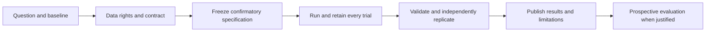

# Contribute research

[Contributing](../../CONTRIBUTING.md) · [Templates](../templates/README.md) · [Review](review.md)

## Research worth contributing

Replicate one result, explain a failure, improve a source contract, test an
alternative baseline, or submit a bounded new hypothesis. Negative results and
inconclusive replications are first-class contributions. Do not use repository
stars, code volume, a high backtest return or LLM confidence as proof of an edge.

This contribution path complements the existing strategy lifecycle. It does not
replace its gates or authorize promotion.

## 1. Propose a bounded question

Use the research issue template or [proposal document](../templates/proposal.md).
State the mechanism, null hypothesis, baseline, metric, universe, currency, horizon,
resource budget and what would falsify the claim. Identify whether the work is
exploratory or confirmatory. A discussion is not approval for a paid feed or a
large compute job. Agree on scope before expensive work.

## 2. Establish data rights and timing

Record source URLs, permissions, geography, units, calendar, currency, price versus
total-return basis, vintage, retrieval time and hashes. Explain corporate actions,
FX alignment, survivorship and missing values. Prefer data-as-known-at-the-time for
historical decisions. Latest-vintage data must be labelled retrospective; it cannot
be silently treated as point-in-time evidence.

Raw licensed histories and private business inputs stay local. Provide legal
retrieval instructions and a small permitted/synthetic fixture. Missing data fails
closed: do not fill it with invented observations or relabel synthetic data as real.

## 3. Freeze the confirmatory plan

Commit the hypothesis, split dates, model configuration, transaction-cost model,
metric definitions and pass/fail criteria **before** evaluating held-out outcomes.
Record the immutable commit in the result. Preserve existing lifecycle formats.
If results have already been viewed, label the work exploratory. Changing a
threshold, universe or parameter after a failure creates a new trial; record it.
A Git timestamp alone does not prove the holdout was never inspected.

## 4. Execute and compare

Include a simple baseline, reproducible commands, pinned environment information,
seeds and run receipts. Report fees, slippage, liquidity and tax exclusions clearly.
Separate terminal loss, temporary loss below initial capital and drawdown from a
running peak. For probabilities, evaluate calibration and error against a baseline;
more simulation paths only reduce simulation noise, not model uncertainty.

Test history length, block/window choices and adverse regimes. Account for repeated
trials and overlapping labels. Do not average unrelated periods or pool overlapping
outcomes as independent evidence. Show failed variants, not just a winner.

## 5. Submit evidence

Use the [result template](../templates/result.md). Link code, source identities,
commands, public-safe aggregates and tests. Produce charts from those same aggregates;
label units, periods, sample counts and uncertainty. Keep missing values missing.
Explain what was executed, merely inspected, blocked or not attempted.

An independent replication means a genuinely separate implementation or verification
path, not running the same helper twice. Repeated identical output establishes
reproducibility, not statistical validity. Prospective evidence requires dated
predictions retained before their outcomes mature.

## 6. Review and disposition

The reviewer records one of these **contribution outcomes**, not trading decisions:

| Outcome | Meaning |
| --- | --- |
| Reproduced within scope | The specified computation agrees; wider claims may remain untested. |
| Discrepancy found | A result, implementation or definition conflicts with the evidence. |
| Negative result | The stated hypothesis or agreed gate failed. |
| Inconclusive | Data, sample size or method cannot resolve the question. |
| Blocked | A named prerequisite prevents the specified evaluation. |

Accepted code or documentation can record any of these outcomes. A merge is not
an endorsement of profitability. Strategy promotion, capital allocation, broker
access and paid infrastructure require separate explicit authorization under the
existing governance. Never loosen a gate merely to obtain promotion.
